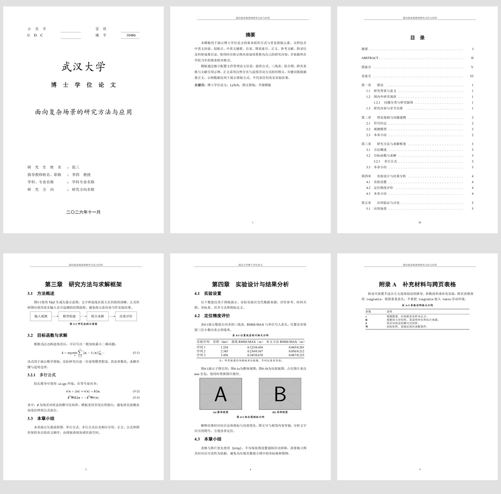

# WHUPhd_2026

面向武汉大学博士学位论文写作的社区 LaTeX 模板，将多轮实际论文排版中形成的改进整理为可复用工程。支持 Windows、Linux 和 macOS，使用 XeLaTeX 编译。

这是社区整理版，格式以使用者所在学院和学校当年要求为准。当前版式参考作者提供的 2022 GNSS 格式材料，不代表所有学院的统一要求。示例正文、声明页、成果及实验数值均为占位内容，提交论文前必须替换。

[正式示例 PDF](examples/PhdTemplate.pdf) · [匿名示例 PDF](examples/ReviewTemplate.pdf) · [更新记录](CHANGELOG.md)



## 快速开始

安装 TeX Live 2024 或更新版本（推荐完整安装），以及 VS Code 的 LaTeX Workshop 扩展。在项目根目录运行：

```sh
latexmk -xelatex -interaction=nonstopmode -halt-on-error -file-line-error PhdTemplate.tex
```

输出为 `build/PhdTemplate.pdf`。`latexmk` 自动完成 BibTeX 和必要的多轮编译。Windows 需要 TeX Live 自带的 Perl 环境；编译器应位于系统 `PATH` 中。

Ubuntu 可以安装：

```sh
sudo apt install latexmk texlive-xetex texlive-lang-chinese texlive-latex-extra texlive-bibtex-extra fonts-texgyre
```

macOS 推荐 MacTeX。Overleaf 选择 `PhdTemplate.tex` 为主文件、XeLaTeX 为编译器，并选择较新的 TeX Live。平台是否支持 `.latexmkrc` 输出目录可能影响下载入口，但不影响正文结构。

## 目录结构

```text
WHUPhd_2026/
├── PhdTemplate.tex          正式示例入口
├── ReviewTemplate.tex       盲审示例入口
├── PortableTemplate.tex     Fandol 字体示例入口
├── thesis-info.tex          中英文题目、作者、导师、日期等
├── whuphd2026.cls           文档类与排版设置
├── frontmatter/             声明占位、创新点、摘要、可选符号说明
├── chapters/                七章通用示例
├── backmatter/              附录、成果目录、致谢
├── references.bib           BibTeX 示例
├── figures/                 自有图片目录
├── examples/                已编译的通用示例 PDF
├── docs/                    排版预览与验证说明
├── .vscode/                 无个人绝对路径的编辑器配置
├── .github/workflows/       Linux 编译工作流
└── build/                   本机生成文件，Git 忽略
```

## 先改哪里

1. 修改 `thesis-info.tex` 中的中英文元信息。封面题目、页眉和 PDF 元数据统一读取这些配置。
2. 替换 `frontmatter/` 中的声明占位、创新点和摘要。关键词命令写在摘要环境内部末尾，自动跟随正文。
3. 修改 `chapters/` 中的章节内容，在 `PhdTemplate.tex` 中增减 `\input`。图表、公式使用 `\label` 和 `\ref` 引用。章节使用 `\input` 以避免独立输出目录缺少辅助文件子目录的问题，`\chapter` 仍会自动另起页。
4. 在 `references.bib` 中加入真实文献，在成果目录中填写真实成果。不要保留示例实验数值。
5. 编译后实际查看 PDF，核对学校要求、长标题换行及页面效果。

## 版本与字体

| 用途 | 编译入口 | 默认输出 |
| --- | --- | --- |
| 正式示例 | `PhdTemplate.tex` | `build/PhdTemplate.pdf` |
| 匿名示例 | `ReviewTemplate.tex` | `build/ReviewTemplate.pdf` |
| 跨平台字体示例 | `PortableTemplate.tex` | `build/PortableTemplate.pdf` |

两个辅助入口的编译命令与正式入口相同，只替换文件名即可。也可以直接修改主文件选项：

```latex
\documentclass{whuphd2026}                  % 连续分页
% \documentclass[review]{whuphd2026}        % 匿名送审
% \documentclass[portable]{whuphd2026}      % 发行版提供的开源字体
% \documentclass[print]{whuphd2026}         % 各章从奇数页开始，可能补空白页
% \documentclass[review,portable]{whuphd2026}
```

默认优先使用本机 Times New Roman，以及宋体、黑体、楷体、仿宋；中文字体不齐时整组回退到 Fandol。`portable` 统一使用 TeX Gyre Termes 和 Fandol，不要求安装商业字体。两套字体会产生不同分页，最终提交应采用学院认可的字体并再次检查。

匿名模式隐藏配置中的作者及导师姓名，清空 PDF 作者元数据，省略声明与致谢，成果目录采用“刊物名称（作者顺序，年份）”的占位形式。它不会扫描正文、图片、参考文献、自定义 PDF 元数据或附件中的身份信息；请检查实际匿名要求和最终文件。摘要题目、学院名称是否需要隐藏，也以实际要求为准。

## 已整理的排版经验

- A4；上下边距 2.54 cm，左右边距 3.17 cm；正文小四号、20 pt 基线间距。标题、页眉页脚、图注和文献另设样式。
- 中文封面“博士学位论文”使用宋体加粗；题目与校名均读取配置，支持自备且获授权的校名图。
- 章级目录项和各级小节均有点线连接页码，长标题与罗马页码预留空间。
- 关键词紧跟摘要，无固定页底 `\vfill`。创新点不设强制一页压缩，请作者控制内容。
- 默认章间连续分页，各章独立起页；可选 `print` 恢复奇数页章起始。
- `\raggedbottom` 配合有界公式间距，减少公式前后被拉大的空白；不以大量负间距补版。
- 图表默认示例采用 `[htbp]`。相邻图文可以穿插，避免逐图 `[H]` 或多重 `\FloatBarrier` 造成整页无法利用的空间。
- 子图采用组合 `figure`，保留完整图例和字号；跨页长表有重复表头。
- 数值列右对齐，指标和单位直接写入表头；小数精度依据指标设置。
- “符号说明”默认不加载。确有要求时，在主文件中取消对应注释。

这些设置有助于减少常见留白，但不能代替对真实长论文逐页检查。不要仅为减少页数缩小图中文字、改动实验数据或删除必要分析。

## 常用修改

引用：`\citet{knuth1984}` 或 `\citep{lamport1994}`。默认使用 TeX 发行版提供的 `gbt7714-author-year`；如需数字顺序编码，请同时将文档类中的 natbib 模式改为 `numbers,sort&compress`，并使用 `gbt7714-numerical` 样式。不要同时加载两套文献管理系统。

图表与公式编号采用“章号-序号”。`chapters/ch04-experiments.tex` 展示三线表和组合图；`backmatter/appendix.tex` 展示 `longtable`；`chapters/ch03-method.tex` 展示矢量图及多行公式。

VS Code 默认手动编译，减少与命令行或作者并发编译冲突。若编译器不在 `PATH` 中，可在 `.vscode/settings.json` 中通过注释切换本机 Windows/Linux 命令，勿把个人路径作为公共仓库默认值。编辑子文件时可在首行加 `% !TeX root = ../PhdTemplate.tex`。

仅清理中间文件：

```sh
latexmk -c PhdTemplate.tex
```

如需移除生成 PDF，可使用 `latexmk -C`，执行前确认目标入口及输出目录。

## 开源与贡献

新增代码及文档采用 MIT 许可；第三方软件、字体和图片各自遵循原许可，详见 `NOTICE.md`。本仓库不包含真实论文、科研数据、个人成果条目、商业字体或学校标识文件。

欢迎提交最小复现示例和格式依据，见 `CONTRIBUTING.md`。GitHub Actions 配置会在上传仓库后编译三种入口并保留 PDF 构建产物；本地目录不会自动发布到 GitHub。
